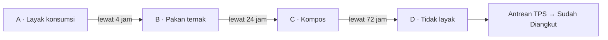

# RE:GIZI

**Platform web penyaluran sisa pangan dapur SPPG (program Makan Bergizi Gratis) kepada penerima terdekat — sebelum sisa itu melewati batas aman dan berakhir di TPA.**

RE:GIZI dikembangkan untuk lomba Web Development **Soedirman Technophoria (S-Tech) 2026**, tema *Byte-Sized Solutions for Global Food Security*, sub-tema *Food Waste & Supply Chain*.

---

## Daftar isi

- [Masalah](#masalah)
- [Cara kerja](#cara-kerja)
- [Fitur utama](#fitur-utama)
- [Teknologi](#teknologi)
- [Menjalankan secara lokal](#menjalankan-secara-lokal)
- [Akun demo](#akun-demo)
- [Mendemokan degradasi dengan jam simulasi](#mendemokan-degradasi-dengan-jam-simulasi)
- [Halaman aplikasi](#halaman-aplikasi)
- [Struktur proyek](#struktur-proyek)
- [Basis data dan migrasi](#basis-data-dan-migrasi)
- [Pengujian](#pengujian)
- [Keamanan](#keamanan)
- [Desain antarmuka](#desain-antarmuka)
- [Batasan](#batasan)
- [Penggunaan alat bantu AI](#penggunaan-alat-bantu-ai)
- [Pengembang](#pengembang)

---

## Masalah

Program Makan Bergizi Gratis (MBG) dijalankan oleh puluhan ribu dapur Satuan Pelayanan Pemenuhan Gizi (SPPG). Kajian Bappenas memperkirakan sisa makanannya dapat mencapai 1,1–1,4 juta ton per tahun. Peraturan Badan Gizi Nasional Nomor 1 Tahun 2026 mewajibkan SPPG mendata dan mengelola sisa pangan, tetapi belum ada alat yang menghubungkan SPPG dengan pihak yang dapat memanfaatkannya dalam jendela waktu yang sempit.

RE:GIZI menjembatani celah itu: petugas SPPG mencatat sisa pangan, sistem menjaga batas amannya, dan penerima yang sesuai di sekitar dapur dapat langsung mengklaim dan mengambilnya.

## Cara kerja

Setiap sisa pangan (*batch*) dicatat petugas SPPG ke salah satu dari empat kategori:

| Kategori | Kondisi | Penerima | Satuan |
|---|---|---|---|
| **A** | Layak konsumsi | UMKM, warga | porsi |
| **B** | Pakan ternak | Peternak | kg |
| **C** | Kompos | Petani, komposter | kg |
| **D** | Tidak layak | Tidak dapat diklaim — diangkut TPS | kg |

Kategori **hanya bisa turun**, tidak pernah naik. Penurunan terjadi otomatis ketika batas aman kumulatif sejak makanan dimasak terlewati, atau lebih awal secara manual oleh petugas SPPG.



Saat sebuah batch turun kategori:

1. klaim yang masih tertunda dibatalkan dan jumlahnya dikembalikan ke sisa batch,
2. satuan porsi dikonversi ke kilogram (`KG_PER_PORTION` = 0,4 kg/porsi),
3. perubahan dicatat di riwayat kategori batch (`batch_category_events`).

Batas aman didefinisikan di satu tempat, `SAFE_WINDOW_HOURS` dalam `src/lib/data/constants.ts`. Batas 4 jam untuk makanan siap santap mengikuti SOP BGN; batas 24 dan 72 jam adalah parameter rancangan yang dapat disesuaikan.

Batas aman selalu dihitung **sejak makanan dimasak**, bukan sejak ompreng dikembalikan, agar sisa yang sudah lama tidak tampak "baru". Karena itu isian waktu di formulir menyesuaikan kategori:

| Kategori | Isian | Pilihan |
|---|---|---|
| A · makanan matang | Selesai dimasak | baru saja – 3 jam lalu |
| A · makanan kering | Layak dikonsumsi sampai | 1, 2, 3, 5, atau 7 hari lagi |
| B | Umur makanan sejak dimasak | 1 – 18 jam lalu |
| C | Umur makanan sejak dimasak | 6 jam – 2,5 hari lalu |
| D | Kira-kira dimasak (hanya catatan) | hari ini – 3 hari lalu |

### Makanan kering

Roti, biskuit, dan makanan kering sejenis tahan lebih lama daripada makanan matang. Untuk Kategori A, petugas dapat memilih jenis **makanan kering** dan menentukan batas layak dari kemasannya (paling lama 7 hari, `DRY_MAX_DAYS`). Setelah batas layak itu lewat, batch tetap turun ke B lalu C dengan selisih yang sama seperti makanan matang: B berlaku sampai 20 jam setelah batas layak, C sampai 68 jam setelahnya, lalu D.

## Fitur utama

- **Pencatatan sisa pangan oleh SPPG** — menu, kategori, jumlah, waktu matang, dan catatan; isian waktu menyesuaikan kategori, termasuk pilihan makanan kering untuk Kategori A.
- **Degradasi kategori otomatis dan manual** beserta riwayat lengkapnya.
- **Daftar dan klaim menurut jenis penerima** — penerima hanya melihat kategori yang boleh ia klaim; daftar dapat diurutkan menurut batas aman atau jarak, dengan tautan arah ke lokasi SPPG. Klaim yang belum diambil menampilkan tenggat pengambilan.
- **Serah terima dengan kode ambil 6 digit** — kode hanya terlihat oleh penerima, lalu dimasukkan dan dikonfirmasi petugas SPPG.
- **Antrean pengangkutan kategori D untuk TPS** — detail batch D hanya terlihat oleh TPS dan SPPG pemiliknya; peran lain hanya melihat angka ringkasan.
- **Dasbor dampak SPPG** — jumlah sisa pangan yang tersalurkan per kategori (dihitung setelah serah terima dikonfirmasi) dan klaim yang masih menunggu diambil.
- **Jam simulasi** untuk demo dan pengujian (dipercepat sampai 600×, dijeda, atau dimajukan).

## Teknologi

| Lapisan | Teknologi |
|---|---|
| Antarmuka | Next.js 16 (App Router), React 19, Tailwind CSS v4, shadcn/ui (Radix UI), lucide-react |
| Logika server | Next.js Server Actions (TypeScript `strict`) |
| Basis data | SQLite (`better-sqlite3`) dengan Drizzle ORM dan migrasi berversi |
| Pengujian | `tsx --test` (data layer TypeScript), pytest (prototipe jam simulasi Python di `api/`) |

## Menjalankan secara lokal

**Prasyarat:** Node.js 20 atau lebih baru (dikembangkan dengan Node.js 22) dan npm.

```bash
git clone https://github.com/DemagaLOL/RE_GIZI.git
cd RE_GIZI
npm install
npm run dev
```

Buka <http://localhost:3000>. Tidak perlu menyiapkan basis data secara manual: saat pertama diakses, file `data/regizi.db` dibuat, dimigrasi, dan diisi akun demo secara otomatis.

Data awal hanya diisi ke basis data yang masih kosong. Bila `data/regizi.db` sudah ada dari versi sebelumnya, jalankan `npm run db:reset` agar akun dan lokasi demo terbaru dipakai.

Untuk build produksi:

```bash
npm run build
npm start
```

### Skrip npm

| Perintah | Fungsi |
|---|---|
| `npm run dev` | Menjalankan server pengembangan |
| `npm run build` / `npm start` | Build dan menjalankan versi produksi |
| `npm run lint` | Pemeriksaan ESLint |
| `npm test` | Menjalankan tes unit data layer |
| `npm run db:generate` | Membuat file migrasi baru setelah skema diubah |
| `npm run db:reset` | Mengosongkan basis data dan mengisi ulang akun demo (aman saat `dev` berjalan) |
| `npm run db:studio` | Membuka Drizzle Studio untuk melihat isi basis data |

### Variabel lingkungan

Semuanya opsional.

| Variabel | Bawaan | Fungsi |
|---|---|---|
| `DATABASE_PATH` | `data/regizi.db` | Lokasi file SQLite |
| `SIM_CLOCK` | — | Isi `1` untuk mengaktifkan jam simulasi di mode produksi (di mode pengembangan selalu aktif) |
| `DEMO_MODE` | — | Isi `1` agar akun demo tampil di halaman masuk dan bisa dipakai di mode produksi (di mode pengembangan selalu aktif). Tanpa ini, login akun `@demo.regizi.id` ditolak karena kata sandinya publik |

## Akun demo

Tersedia satu akun untuk setiap peran. Semua akun demo memakai kata sandi **`regizi123`**. Di mode produksi akun demo hanya aktif bila `DEMO_MODE=1`, dan akun demo tidak ikut dikunci setelah salah kata sandi berulang. Penerima baru juga dapat mendaftar sendiri di `/daftar`; akun SPPG dan TPS hanya tersedia dari data awal.

| Peran | Email | Nama |
|---|---|---|
| SPPG | `sppg@demo.regizi.id` | SPPG Blater (Kalimanah, Purbalingga) |
| Penerima · UMKM | `umkm@demo.regizi.id` | Warung Makan Bu Sri |
| Penerima · Warga | `warga@demo.regizi.id` | Dasawisma Melati RW 02 |
| Penerima · Peternak | `peternak@demo.regizi.id` | Kelompok Budidaya Lele Mina Makmur |
| Penerima · Petani | `petani@demo.regizi.id` | Kelompok Tani Sido Makmur |
| Penerima · Komposter | `komposter@demo.regizi.id` | Rumah Kompos Perwira |
| TPS | `tps@demo.regizi.id` | TPST Purbalingga |

Data contoh berada di Kabupaten Purbalingga, dengan SPPG di Desa Blater, Kalimanah.

## Mendemokan degradasi dengan jam simulasi

Menunggu 4 jam sungguhan tidak praktis untuk demo, jadi seluruh waktu domain sisa pangan memakai jam aplikasi yang dapat disimulasikan.

1. Masuk sebagai `sppg@demo.regizi.id`, lalu catat satu batch Kategori A.
2. Masuk sebagai `umkm@demo.regizi.id` di jendela lain, lalu klaim sebagian batch tersebut.
3. Kembali ke akun SPPG, buka **`/waktu`**, dan percepat atau majukan jam lebih dari 4 jam.
4. Batch turun ke Kategori B, klaim yang tertunda dibatalkan, dan batch kini tampil untuk peternak. Riwayat perubahannya dapat dilihat di detail batch.
5. Lanjutkan sampai Kategori D, lalu masuk sebagai `tps@demo.regizi.id` dan tandai batch "Sudah Diangkut".

Sesi login tetap memakai waktu nyata, sehingga mempercepat jam tidak membuat sesi kedaluwarsa.

Jam simulasi tidak dapat dimundurkan. Untuk memulai ulang dari keadaan bersih, tekan **Reset jam & data demo** di `/waktu` (tersedia dalam mode demo) atau jalankan `npm run db:reset`. Keduanya mengosongkan seluruh data dan mengisi ulang akun demo.

## Halaman aplikasi

| Rute | Isi |
|---|---|
| `/` | Beranda dan ringkasan dampak |
| `/tentang`, `/kontak` | Pengenalan produk dan kontak |
| `/masuk`, `/daftar` | Masuk dan pendaftaran penerima |
| `/dasbor` | Dasbor SPPG: dampak, konfirmasi pengambilan, dan daftar batch beserta klaim dan riwayatnya |
| `/dasbor/baru` | Pencatatan sisa pangan (SPPG) |
| `/sisa-makanan` | Daftar sisa pangan yang dapat diklaim |
| `/sisa-makanan/[id]` | Detail batch dan klaim |
| `/klaim-saya` | Klaim milik penerima beserta kode ambil |
| `/pembuangan` | Antrean pengangkutan Kategori D (TPS) |
| `/waktu` | Pengaturan jam simulasi (SPPG) |

## Struktur proyek

Kode disusun per fitur. Folder `src/app` hanya berisi routing yang tipis; logika berada di `src/features`, dan seluruh akses data melewati satu pintu, `src/lib/data`.

```
src/
  app/                  # Routing: (marketing), (auth), (app) — masing-masing dengan layout sendiri
  features/             # Satu folder per fitur: komponen, Server Actions, public API (index.ts)
    listing/            #   daftar dan detail sisa pangan
    claim/              #   klaim dan kode ambil
    disposal/           #   antrean TPS
    dashboard-sppg/     #   pencatatan, konfirmasi pengambilan, degradasi manual, dasbor dampak
    sim-clock/          #   jam simulasi
    session/            #   sesi, navigasi per peran
    landing/ about/ contact/
  components/
    ui/                 # Primitif shadcn/ui
    shared/             # Komponen lintas fitur (mis. FoodStatusBadge)
  lib/
    data/               # Data layer: aturan domain, akses basis data, seed, tes
      db/               #   skema Drizzle dan klien SQLite
drizzle/                # File migrasi SQL berversi
scripts/                # Skrip utilitas (db-reset)
api/                    # Prototipe jam simulasi dalam Python beserta tes pytest (tidak dipakai aplikasi web)
```

Aturan domain yang penting ada di `src/lib/data`:

- `constants.ts` — batas aman, batas makanan kering, penerima yang berhak per kategori, konversi porsi ke kg
- `degradation.ts` — penurunan kategori otomatis dan manual, termasuk jendela makanan kering
- `claim-cancel.ts` — pembatalan klaim saat batch turun kategori
- `disposals.ts`, `disposal-core.ts` — antrean dan pencatatan pengangkutan TPS
- `clock.ts` — jam aplikasi dan simulasinya
- `geo.ts` — perhitungan jarak (haversine)

## Basis data dan migrasi

Skema didefinisikan di `src/lib/data/db/schema.ts` dan migrasinya disimpan di folder `drizzle/` (ikut di-commit). File basis data di `data/` tidak di-commit.

Setelah mengubah skema:

```bash
npm run db:generate
```

Migrasi diterapkan otomatis saat aplikasi berjalan.

## Pengujian

```bash
npm test
```

Menjalankan 52 tes unit untuk aturan degradasi (termasuk makanan kering), pembatalan klaim, pengangkutan TPS, jam simulasi, validasi dan pembulatan jumlah, serta perhitungan jarak. Sebagian tes berjalan terhadap basis data SQLite sementara.

Tes untuk prototipe Python di `api/`:

```bash
cd api
pip install pytest
python -m pytest
```

## Keamanan

- Kata sandi di-*hash* dengan scrypt dan salt acak; hash tidak pernah keluar dari data layer.
- Token sesi disimpan dalam bentuk ter-*hash*.
- Setelah 5 kali gagal masuk, email dikunci selama 15 menit. Pesan galat tidak membedakan email tak terdaftar dan kata sandi salah, dan waktu respons dibuat setara.
- Pemeriksaan hak akses dilakukan di sisi server: penerima hanya dapat melihat dan mengklaim kategori yang sesuai (termasuk saat membuka tautan detail langsung), dan detail batch Kategori D hanya terlihat oleh TPS dan SPPG pemiliknya.
- Kode ambil tidak ditampilkan di dasbor SPPG, sehingga serah terima hanya bisa dikonfirmasi dengan kode dari penerima.

## Desain antarmuka

- *Mobile-first* dengan target sentuh minimal 44 px; seluruh teks antarmuka berbahasa Indonesia.
- Nuansa hijau–oranye hangat di atas latar krem. Setiap kategori punya warna tetap di semua halaman: hijau (A), oranye (B), cokelat tanah (C), dan abu hangat (D), ditampilkan lewat satu komponen `FoodStatusBadge`.
- Tipografi Plus Jakarta Sans untuk teks dan Geist Mono untuk angka serta kode ambil; sudut membulat 12 px.
- Warna didefinisikan sebagai token CSS (`oklch`) di `src/app/globals.css`, termasuk mode gelap.

## Batasan

- Kategori ditentukan petugas SPPG dan batas aman berbasis aturan waktu; RE:GIZI tidak menggantikan uji laboratorium keamanan pangan.
- Batas layak makanan kering mengikuti pilihan petugas berdasarkan kemasan (paling lama 7 hari); sistem tidak membaca tanggal kedaluwarsa secara otomatis.
- RE:GIZI tidak memproses pembayaran dan tidak menyediakan armada; penerima menjemput sendiri.
- Penerima mendaftar sendiri tanpa verifikasi; akun SPPG dan TPS dibuat dari data awal.
- Jarak dihitung sebagai garis lurus, bukan jarak tempuh jalan.
- SQLite membutuhkan disk persisten, sehingga aplikasi ini tidak cocok dijalankan di hosting *serverless* seperti Vercel tanpa mengganti basis data.
- Data yang tersedia adalah data contoh; aplikasi belum diuji dengan data operasional SPPG.

## Penggunaan alat bantu AI

Pengembangan dibantu Claude Code sebagai asisten pemrograman untuk kerangka kode, *refactoring*, dan dokumentasi. Rancangan produk, aturan domain, dan hasil pengujian ditinjau oleh pengembang.

## Pengembang

**Danawendra Girinandana** — Universitas Jenderal Soedirman
